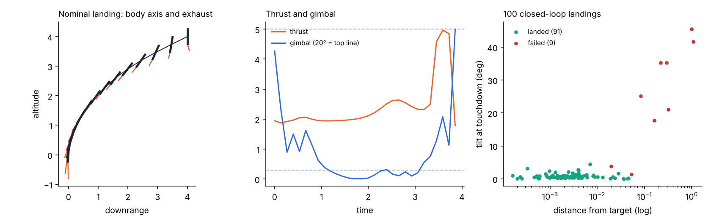

# 6-DOF landing guidance (c++)

`cpp/` plans full rigid-body landings. state = mass, position, velocity, attitude (quaternion), body rates. the engine gimbals, so steering the thrust is also how the thing rotates.

method is **successive convexification** (SCvx, mao / szmuk / açıkmeşe 2016) with free final time, same as szmuk & açıkmeşe, *successive convexification for 6-DoF mars rocket powered landing with free-final-time* (AIAA 2018-0617). each iteration:
1. linearise the nonlinear dynamics around the last trajectory
2. discretise exactly with a first-order hold, state transition matrices integrated with RK4
3. solve one SOCP with ECOS via the epigraph modelling lib
4. repeat until the trust region + dynamics slack ("virtual control") go to zero

constraints:
- thrust between min and max (the non-convex min gets linearised each iteration)
- 20° gimbal
- 75° tilt
- 60°/s body rate
- 20° glide slope
- dry mass floor
- touch down upright, no pitch/yaw rate, at a set speed

the horizontal landing point is a penalty, not a hard constraint. as a hard constraint tiny disturbances made the problem infeasible (more on that below).



## checks

| check | result |
|---|---|
| separate implementation: python, CVXPY + clarabel (different solver), adaptive RK45 (different integrator) | propellant within 0.0001%, flight time within 1×10⁻⁵, every state within 4×10⁻⁵ |
| c++ controls flown through the nonlinear model with DOP853 at 10⁻¹⁰ tolerance | lands within 3.4×10⁻⁷ of the planned state |
| lower bound: same landing as a point mass, solved exactly with lossless convexification | 6-DOF burns 22% more, that's the price of having to rotate at a limited rate |
| solve time, nominal landing | c++ 0.29s for 5 iterations, python 17s (59× slower) |

everything's non-dimensional (gravity 1, wet mass 2, dry mass 1).

## closed loop: 100 landings with model errors

the "truth" model is deliberately different from what the planner thinks:
- start position ±0.4 to ±1
- start velocity ±0.3 to ±0.5
- mass error 2%
- inertia error 10%
- thrust error 2%
- engine misalignment 0.005 rad (a torque the planner has no idea about)
- steady side force of 3% of gravity

every 0.2 time units the planner re-solves from the measured state, warm started from its last plan. an attitude tracking loop runs on top: quaternion PD on the planned attitude through the gimbal, plus thrust magnitude feedback on position + velocity error.

| version | landed upright on target* |
|---|---|
| follow the plan open loop | basically none, errors just grow |
| + attitude tracking loop | 74 |
| + soft landing point so re-plans stay feasible | 82 |
| + re-plan every 0.2 instead of 0.4, until 0.15 before touchdown | **91** |

\* success = all of: within 0.05 of target, sink rate < 0.3, sideways speed < 0.15, tilt < 5°.

for the ones that landed:
- **miss distance:** median 0.003
- **tilt at touchdown:** median 0.7°

**why the 9 fail:** they all show up with big sideways errors late in the descent. sideways position only gets fixed by re-planning, and the last 0.15 time units are flown on the tracking loop alone. a faster solver would let it re-plan all the way down. so would a lateral position loop that tilts the vehicle, but bolting one on naively made it *worse* (63%) because it fought the attitude plan.

**speed:** median re-plan is 0.5s on this 2-core box vs a 0.2 time unit period. at a 100 m length scale one time unit ≈ 3.2s, so the period is ~0.64s. keeps up on average, not in the worst case (5s). real flight software uses custom interior-point solvers (e.g. dueri et al., JGCD 2017) that do this class of problem in milliseconds.

## build + run

```bash
sudo apt install libeigen3-dev cmake g++
cmake -S cpp -B cpp/build && cmake --build cpp/build -j     # pulls epigraph (MIT) with ECOS (GPLv3)
cpp/build/rocket6dof > landing.json                         # one landing + its own nonlinear check
cpp/build/rocket6dof_mc 100 7 > mc.json                     # closed-loop monte carlo
python3 bench/scvx6_ref.py                                  # python reference, nonlinear check, 3-DOF bound
```

**licence heads up:** the c++ binaries link ECOS which is GPLv3, so anything built from `cpp/` is GPLv3. the rest of the repo stays MIT.
