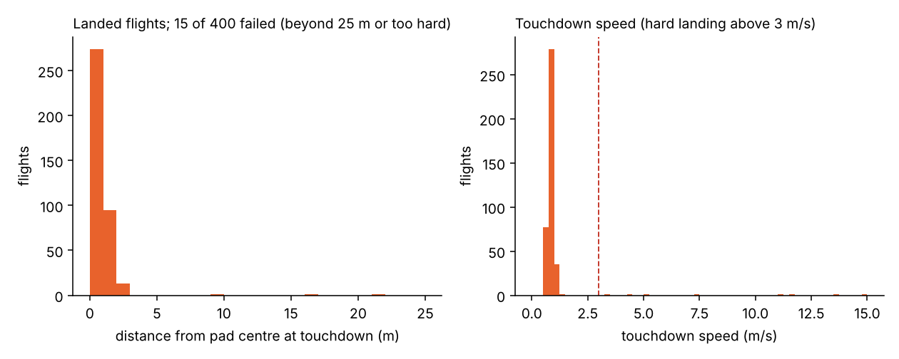

# validation

guidance is only worth anything if 3 things hold:
1. the optimiser actually solves its problem
2. it's solving the *right* problem
3. the closed loop lands when the real world gets messy

each one got checked on its own against references that share no code with the app. everything here re-runs from `bench/`.

## 1. my solver vs clarabel and ECOS

the planner's convex solver (ADMM + second-order cone projections, written from scratch in JS) got 200 random fixed-time landing problems. same problems built separately in CVXPY and solved with clarabel and ECOS, two proper interior-point solvers.

| | result |
|---|---|
| problems | 200 (booster, 1.2 to 2.5 km up, 70 to 100 m/s down, random offsets + flight times) |
| feasible per the reference | 193 |
| fuel diff where both solved | median 0.0005%, worst 0.0025% |
| worst constraint violation in my answers | 1.2×10⁻⁴ (scaled units, ~0.25 m) |
| called feasible but reference proves infeasible | 0 |
| feasible ones mine gave up on | 1 (the safe direction, planner just tries another flight time) |
| median solve time | mine 78 ms (JS, iterative), clarabel 3.6 ms, ECOS 3.6 ms |


**bug this caught:** first run had one problem mine called feasible that both references prove infeasible. its residual crawled down to 1.4×10⁻³ after a lot of iterations and slipped past a loose threshold. converged feasible problems finish under 1×10⁻⁴, infeasible ones stall above 1×10⁻³, so the threshold is 2×10⁻⁴ now and it splits them cleanly.

**speed:** yeah the interior-point solvers are ~20× faster. mine exists so the whole thing runs in a browser tab with no deps. for actual flight code you'd want a compiled interior-point or custom-generated solver (like dueri et al., *customized real-time interior-point methods for onboard powered-descent guidance*, JGCD 2017).

## 2. full planner vs G-FOLD

the app handles changing mass by successive approximation: solve for thrust acceleration with bounds from an estimated mass profile, then re-solve with the mass that plan actually burns. plus a search over flight time. the reference is the exact lossless-convexification problem from açıkmeşe & ploen (JGCD 2007) and blackmore, açıkmeşe & scharf (JGCD 2010):
- log-mass state
- second-order taylor bounds on thrust
- solved with clarabel
- bounded scalar search over flight time

cases:
- **mars lander** from blackmore et al. 2010 case 1: 1,905 kg wet, 1,505 kg dry, 4,972 to 13,260 N, isp 225s, mars gravity, starting 1.5 km up, 2 km out, 75 m/s down, 100 m/s across
- **19 random earth booster descents**

(a 20th booster and a mars variant with a 30° glide slope are infeasible, both planners agree.)

| | before fix | after fix |
|---|---|---|
| extra propellant vs G-FOLD, worst | 3.6% | 0.14% |
| extra propellant, median | ~2.5% | 0.00% (a few come out 0.03% *better*, from the reference's conservative taylor bound) |
| mars case: flight time / propellant | 85.1s / 366.0 kg | **79.2s / 362.5 kg** (G-FOLD: 79.4s / 362.5 kg) |
| worst thrust limit breach when flown with true mass flow | 1.0% | 0.06% |


**bug this caught:** the first mass guess assumed 60% throttle. that made the bounds too tight near the shortest (fuel-optimal) flight times, so the search wrongly threw them out and settled 1 to 6s later, burning 1 to 3.6% extra. it also only did two refinement passes, so plans could overshoot the engine limit by up to 1% once flown with real mass flow. fix:
- start from the lightest possible mass profile (full thrust)
- keep iterating until fuel changes by less than 0.01%

(our mars flight time also lines up with the 78.4s in a separate [reproduction of the blackmore paper](https://ece.uwaterloo.ca/~ece602/Projects/2016/Project9/main.html), which uses a different time step.)

## 3. closed loop monte carlo, 400 full flights

every flight is the real loop:
- 120 Hz point mass dynamics with drag
- ornstein-uhlenbeck gusts
- re-plan every 1.5s
- tracking controller on top of the plan
- engine limits enforced on the actual thrust

dispersions:
- start altitude +0 to 15%
- downrange + crossrange ±40%
- sideways speeds ±30%
- sink rate −10 to +5%
- steady wind 0 to 12 m/s from anywhere, gusts up to 3 m/s
- in 20% of flights an engine fault partway down cuts max thrust to 85–95%

| | flights | on the pad |
|---|---|---|
| no fault | 320 | **320 (100%)** |
| fault leaving ≥87% thrust | 62 | **62 (100%)** |
| fault leaving <87% thrust | 18 | 3 (7 more touched down intact off the pad, 4 hard off the pad, 4 lost) |
| **all** | **400** | **385 (96.3%, 95% CI 93.9–97.7%)** |

for the ones that landed:
- **touchdown speed:** median 0.82 m/s, p95 1.02 m/s
- **distance from pad centre:** median 0.56 m, p95 1.9 m



**why deep faults fail:** the planner holds a 14% thrust reserve, it plans at 86% of max. a fuel-optimal landing ends in a max-thrust burn. lose more than the reserve during that burn and there's physically no way to stop in the height you've got left. the results show that edge really sharply: every fault leaving ≥87% survived, almost none below.

that's a design tradeoff, not the solver failing. bigger reserve = survive deeper faults, but you pay propellant on every flight. next step would be retargeting to the nearest reachable spot (the minimum-landing-error formulation from blackmore et al. 2010). tried a simple version, it never triggered here because the limit was vertical (no height left) not horizontal, so it didn't stay.

```bash
node bench/inner_js.js 200 bench/out/inner.json 2500 && python3 bench/inner_ref.py bench/out/inner.json bench/out/inner_cmp.json
python3 bench/full_ref.py
node bench/monte_carlo.js 0 200 bench/out/mc_0.json   # + 200 200 bench/out/mc_1.json, ~7s per flight
python3 bench/plots.py
```

## what this doesn't prove

- **3-DOF only** in the app. point mass, ideal attitude control. real boosters need 6-DOF with attitude dynamics (that's what `cpp/` and [SIXDOF.md](SIXDOF.md) are for)
- flat ground, constant gravity, no planet rotation
- no sensor noise or nav filter, the controller sees the true state
