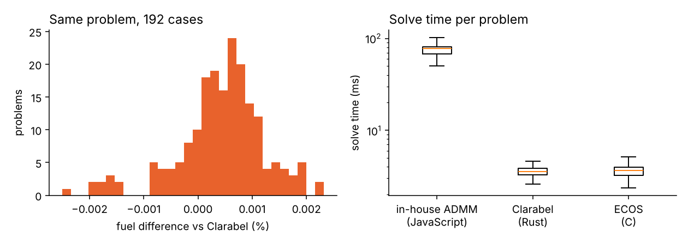
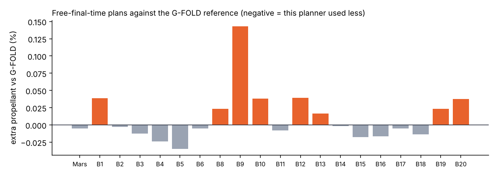

# Validation

Three things have to be true for a guidance system to be worth anything:
1. The optimiser must solve its problem exactly.
2. The problem it solves must be the right one.
3. The closed loop must land under realistic disturbances.

Each was checked separately against references that share no code with the app. Everything below re-runs from `bench/`.

## 1. The in-house solver against Clarabel and ECOS

The planner's convex solver (ADMM with second-order cone projections, written from scratch in JavaScript) was given 200 random fixed-time landing problems. The same problems, built independently in CVXPY, were solved with Clarabel and ECOS, two established interior-point solvers.

| | Result |
|---|---|
| Problems | 200 (booster, 1.2 to 2.5 km up, 70 to 100 m/s down, random offsets and flight times) |
| Feasible according to the reference | 193 |
| Fuel difference on problems both solved | median 0.0005%, worst 0.0025% |
| Worst constraint violation of the in-house answer | 1.2×10⁻⁴ (scaled units, about 0.25 m) |
| Problems called feasible that the reference proves infeasible | 0 |
| Feasible problems the in-house solver gave up on | 1 (the safe direction: the planner tries another flight time) |
| Median solve time | in-house 78 ms (JavaScript, iterative); Clarabel 3.6 ms; ECOS 3.6 ms |



**Bug found and fixed.** The first run found one problem the in-house solver called feasible but both references prove infeasible. Its residual had crept down to 1.4×10⁻³ after many iterations and passed a loose threshold. Converged feasible problems end below 1×10⁻⁴ and infeasible ones stall above 1×10⁻³, so the threshold is now 2×10⁻⁴, which separates them cleanly.

**Speed.** The interior-point solvers are about 20× faster. The in-house solver exists so the whole planner runs in a browser tab with no dependencies; for flight code a compiled interior-point or custom-generated solver (as in Dueri et al., *Customized Real-Time Interior-Point Methods for Onboard Powered-Descent Guidance*, JGCD 2017) is the right choice.

## 2. The full planner against G-FOLD

The app's planner handles changing mass by successive approximation. It solves for thrust acceleration with acceleration bounds from an estimated mass profile, then re-solves with the mass the solution actually burns. It also searches over flight time. The reference is the exact lossless-convexification problem of Açıkmeşe and Ploen (JGCD 2007) and Blackmore, Açıkmeşe and Scharf (JGCD 2010):
- a log-mass state;
- the second-order Taylor bounds on thrust;
- solved with Clarabel;
- a bounded scalar search over flight time.

Cases:
- **Mars lander** from Blackmore et al. 2010, case 1: 1,905 kg wet, 1,505 kg dry, 4,972 to 13,260 N, Isp 225 s, Mars gravity, starting 1.5 km up and 2 km out at 75 m/s down and 100 m/s across.
- **19 random Earth booster descents.**

(A 20th booster and a Mars variant with a 30° glide slope are infeasible, and both planners agree.)

| | Before fix | After fix |
|---|---|---|
| Extra propellant vs G-FOLD, worst case | 3.6% | 0.14% |
| Extra propellant, median | about 2.5% | 0.00% (some cases 0.03% better, from the reference's conservative Taylor bound) |
| Mars case: flight time / propellant | 85.1 s / 366.0 kg | **79.2 s / 362.5 kg** (G-FOLD: 79.4 s / 362.5 kg) |
| Worst thrust-limit breach when the plan is flown with true mass flow | 1.0% | 0.06% |



**Bug found and fixed.** The first mass guess assumed 60% throttle. That made the bounds too tight near the fuel-optimal (shortest) flight times, so the search wrongly rejected them and settled 1 to 6 s later, burning 1 to 3.6% extra propellant. Only two refinement passes were made, so the plans could also exceed the engine limit by up to 1% once flown with real mass flow. The fix:
- start from the lightest possible mass profile (full thrust);
- iterate until the fuel changes by less than 0.01%.

(Our Mars flight time also lines up with the 78.4 s used in an independent [reproduction of the Blackmore paper](https://ece.uwaterloo.ca/~ece602/Projects/2016/Project9/main.html), which uses a different time step.)

## 3. Closed-loop Monte Carlo: 400 full flights

Each flight is the real loop:
- 120 Hz point-mass dynamics with drag;
- Ornstein–Uhlenbeck gusts;
- re-planning every 1.5 s;
- a tracking controller on top of the plan;
- engine limits enforced on the actual thrust.

Dispersions:
- start altitude +0 to 15%;
- downrange and crossrange ±40%;
- sideways speeds ±30%;
- sink rate −10 to +5%;
- steady wind 0 to 12 m/s from any direction, gusts up to 3 m/s;
- in 20% of flights, an engine fault partway down that cuts maximum thrust to 85–95%.

| | Flights | Landed on the pad |
|---|---|---|
| No fault | 320 | **320 (100%)** |
| Fault leaving 87% or more thrust | 62 | **62 (100%)** |
| Fault leaving under 87% thrust | 18 | 3 (7 more touched down intact off the pad, 4 hard off the pad, 4 lost) |
| **All** | **400** | **385 (96.3%, 95% CI 93.9–97.7%)** |

For landed flights:
- **Touchdown speed:** median 0.82 m/s, 95th percentile 1.02 m/s.
- **Distance from pad centre:** median 0.56 m, 95th percentile 1.9 m.


**Why the deep faults fail.** The planner keeps a 14% thrust reserve: it plans with 86% of maximum thrust. A fuel-optimal landing ends in a maximum-thrust burn. A fault that removes more than the reserve during that burn leaves no way to stop in the height that is left. The results show this boundary sharply: every fault that left 87% or more was survived, and almost none below it.

This is a design trade-off, not a solver failure. A larger reserve survives deeper faults at the cost of propellant on every flight. The natural next step is to retarget to the nearest reachable site, the minimum-landing-error formulation of Blackmore et al. 2010. A simple version was tried, but it never triggered in these cases, because the limit was vertical (no height left to stop in) rather than horizontal, so it was not kept.

```
node bench/inner_js.js 200 bench/out/inner.json 2500 && python3 bench/inner_ref.py bench/out/inner.json bench/out/inner_cmp.json
python3 bench/full_ref.py
node bench/monte_carlo.js 0 200 bench/out/mc_0.json   # and 200 200 bench/out/mc_1.json; about 7 s per flight
python3 bench/plots.py
```

## What this does not show

- **3-DOF only.** The vehicle is a point with ideal attitude control. Real boosters need 6-DOF guidance with attitude dynamics, for example successive convexification (Szmuk and Açıkmeşe, 2018).
- **Flat ground, constant gravity, no planetary rotation.**
- **No sensor noise or navigation filter.** The controller sees the true state.
